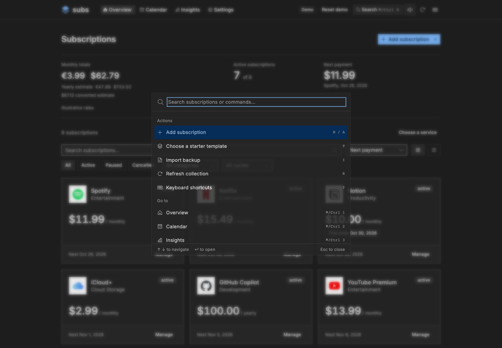
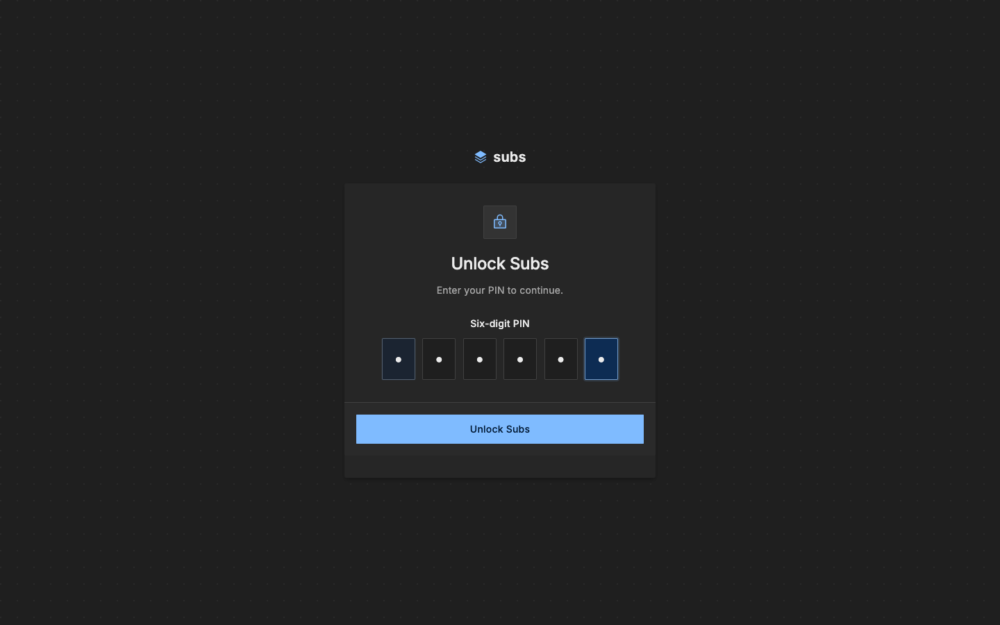

# Subs

Track subscriptions, renewals, and recurring costs.

[Try the demo](https://sub.ajnart.dev) · [Self-host](#docker)


<details>
<summary>Light mode and mobile</summary>


</details>

<details>
<summary>Keyboard search and private unlock</summary>




</details>

## Collection first

Home opens with your subscriptions. Expand **Collection tools** for totals, search, filters, sorting, and bulk actions; press **/** to open search directly. Calendar, Insights, and Settings stay available when you need more detail.

## Quick setup

Choose several service presets or paste website links, then enter each plan's price and billing cycle in one review. Nothing is saved until you confirm the batch; prices start empty, and zero-cost plans are supported. Possible duplicates stay visible so separate plans are never silently merged.

Use **Add subscription** for a single plan, with a service preview and optional custom icon URL. You can move a new draft into quick setup without losing its details.

## Keyboard first

Press **⌘/Ctrl K** to search subscriptions, starter templates, and commands. Hold **⌘ or Ctrl** to reveal shortcuts; use arrows or J/K between subscriptions and Enter to manage one. **?** shows the full shortcut list. The speaker button controls TIKS interaction sounds on this device.

**Settings → Browser reminders** enables renewal and trial notifications on this device. Reminders need HTTPS or localhost and run best effort while Subs is open and unlocked, not after the browser is closed. Sound and reminder settings stay local and are not included in backups.

## Docker

```sh
docker compose up --build -d
docker compose logs subs
```

Open http://localhost:7574. Copy the setup token from the logs and choose a six-digit PIN. Data stays in the mounted `./data` directory; back it up before updating. Use HTTPS and set `SUBS_ORIGIN` when exposing Subs through a reverse proxy.

[Backup, upgrade, and rollback](docs/self-hosting.md)

## Development

Requires [Bun](https://bun.sh/) 1.4.3+.

```sh
bun install --frozen-lockfile --linker hoisted
bun run dev
```

Open http://localhost:5173. `bun run lint`, `bun run typecheck`, and `bun run test` run the checks. `bun run build` builds both targets; `bun run start` starts the private server.

## Static demo

```sh
bun run dev:demo
bun run deploy:demo
```

The demo uses sample data stored only in your browser, illustrative exchange rates, and no backend or PIN. Reset restores the samples. Wrangler builds and publishes `dist/demo` at `sub.ajnart.dev`; `subs.ajnart.dev` remains a compatibility alias. Ordinary local and Docker builds never publish.

The Checks workflow is configured for automatic `main` deployments and explicit manual demo deployments after application and Docker checks pass. Both require the repository's `CLOUDFLARE_API_TOKEN` Actions secret with scoped Cloudflare deployment permissions; without it, deployment stops at the credential preflight.

## Configuration

| Variable             | Default                     | Use                                    |
| -------------------- | --------------------------- | -------------------------------------- |
| `DATA_DIR`           | `./data`, `/data` in Docker | Database directory                     |
| `SQLITE_PATH`        | `<DATA_DIR>/subs.sqlite`    | Override database file                 |
| `SUBS_SETUP_TOKEN`   | Generated in server logs    | First-use operator token               |
| `SUBS_ORIGIN`        | Request origin              | Public origin behind a proxy           |
| `SUBS_COOKIE_SECURE` | Enabled on HTTPS            | Explicit Secure-cookie override        |
| `DISABLE_AUTH`       | `false`                     | Exactly `true` disables PIN protection |

## Existing data

Export from Subs 2 or preserve `data/config.json`, then restore through **Settings → Import**. Legacy arrays and browser/server storage envelopes are supported. Review the preview before replacing anything; keep the original backup. `USE_LOCAL_STORAGE` and the old storage API are retired.

JSON backups contain subscriptions and preferences, including custom icon URLs, not PINs, sessions, or recorded price history. Collections are bounded to a restorable 2 MiB backup. Known service icons are bundled; custom public HTTP(S) icon URLs and other public service favicons load directly in your browser without a referrer, never through a server proxy. Unsafe schemes and recognizable private/local addresses are blocked; DNS and redirects remain browser-controlled. Hovering or focusing a public service link requests a preview from Microlink; previews do not load automatically.

## Lost PIN

Stop Subs and back up `./data`, then:

```sh
docker compose run --rm --no-deps subs bun scripts/reset-pin.ts --confirm
docker compose up -d subs
docker compose logs subs
```

Complete setup again. Subscriptions and preferences are preserved.
