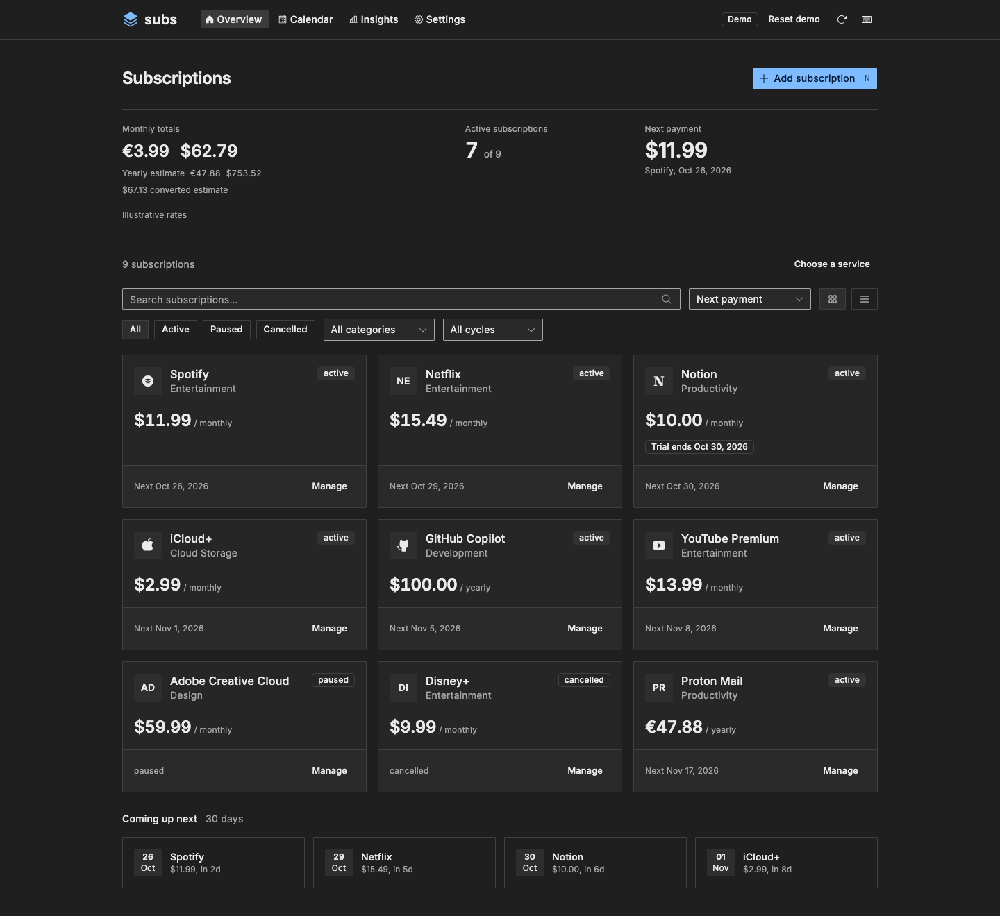
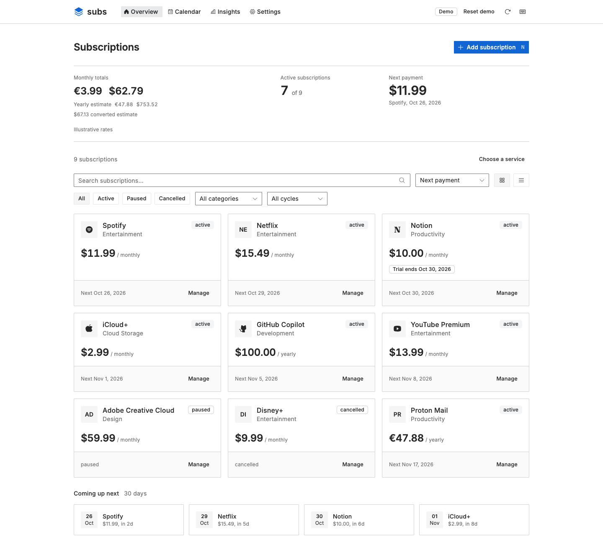
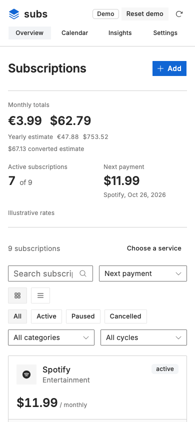

# Subs

Track subscriptions, renewals, and recurring costs.

[Try the demo](https://subs.ajnart.dev) · [Self-host](#docker)



<details>
<summary>Light mode and mobile</summary>




</details>

## Docker

```sh
docker compose up --build -d
docker compose logs subs
```

Open http://localhost:7574. Copy the setup token from the logs and choose a six-digit PIN. Data stays in the mounted `./data` directory; back it up before updating. Use HTTPS and set `SUBS_ORIGIN` when exposing Subs through a reverse proxy.

[Backup, upgrade, and rollback](docs/self-hosting.md)

## Development

Requires [Bun](https://bun.sh/) 1.4.3+.

```sh
bun install --frozen-lockfile --linker hoisted
bun run dev
```

Open http://localhost:5173. `bun run lint`, `bun run typecheck`, and `bun run test` run the checks. `bun run build` builds both targets; `bun run start` starts the private server.

## Static demo

```sh
bun run dev:demo
bun run deploy:demo
```

The demo uses sample data stored only in your browser, illustrative exchange rates, and no backend or PIN. Reset restores the samples. Wrangler builds and publishes `dist/demo` at `subs.ajnart.dev`; ordinary local and Docker builds never publish.

CI deploys successful `main` builds automatically. Set the repository's `CLOUDFLARE_API_TOKEN` Actions secret with scoped Workers deployment permissions. The Checks workflow also supports an explicit manual demo deployment.

## Configuration

| Variable             | Default                     | Use                                    |
| -------------------- | --------------------------- | -------------------------------------- |
| `DATA_DIR`           | `./data`, `/data` in Docker | Database directory                     |
| `SQLITE_PATH`        | `<DATA_DIR>/subs.sqlite`    | Override database file                 |
| `SUBS_SETUP_TOKEN`   | Generated in server logs    | First-use operator token               |
| `SUBS_ORIGIN`        | Request origin              | Public origin behind a proxy           |
| `SUBS_COOKIE_SECURE` | Enabled on HTTPS            | Explicit Secure-cookie override        |
| `DISABLE_AUTH`       | `false`                     | Exactly `true` disables PIN protection |

## Existing data

Export from Subs 2 or preserve `data/config.json`, then restore through **Settings → Import**. Legacy arrays and browser/server storage envelopes are supported. Review the preview before replacing anything; keep the original backup. `USE_LOCAL_STORAGE` and the old storage API are retired.

JSON backups contain subscriptions and preferences, not PINs, sessions, or recorded price history. Collections are bounded to a restorable 2 MiB backup. Hovering or focusing a public service link requests a preview from Microlink; previews do not load automatically.

## Lost PIN

Stop Subs and back up `./data`, then:

```sh
docker compose run --rm --no-deps subs bun scripts/reset-pin.ts --confirm
docker compose up -d subs
docker compose logs subs
```

Complete setup again. Subscriptions and preferences are preserved.
